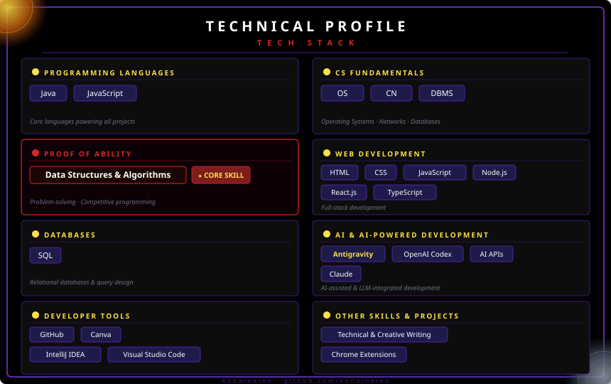

  

   

  
  
  

---

## ⚡ LeetCode Progress

  
  
  
  
  

    

  <!-- Amber-Gold Glow LeetCode Submission Heatmap on Obsidian Purple -->
  

    

  <table border="0" cellspacing="8" cellpadding="0">
    <tr>
      <td align="center">
        
      </td>
    </tr>
  </table>

---

## 🐙 GitHub Contribution Grid

  <table border="0" cellspacing="0" cellpadding="16" style="background-color: #05000a; border-radius: 12px;">
    <tr>
      <td align="center">
        
      </td>
    </tr>
  </table>

---

## 🛠️ Technical Profile

  

---

## 📊 Comprehensive Profile Metrics

| Metric | Value | Detail |
| :--- | :--- | :--- |
| **LeetCode Profile** | [`@smkyuzarsif`](https://leetcode.com/smkyuzarsif/) | Public Profile |
| **Global Ranking** | **#339,788** | Across active global participants |
| **Total Solved** | **391** | Verified AC problems |
| **Contest Rating** | **1530.99** | #323,721 ranking (Top 36.83%) |
| **Contests Attended** | **22** | Live weekly & biweekly contests |
| **Streak Tracking** | **2 days** (Current) | **144 days** (Longest active) |
| **Earned Badges** | **3** | Special challenge medals |
| **Last Synced** | `October 17, 2026 at 09:47 UTC` | Automated via GitHub Actions |

## 🎯 Difficulty Breakdown

| Difficulty | Solved | Ratio | Visual Badge |
| :--- | :---: | :---: | :---: |
| 🟢 **Easy** | **212** | `54.2%` |  |
| 🟡 **Medium** | **161** | `41.2%` |  |
| 🔴 **Hard** | **18** | `4.6%` |  |
| 🏆 **Total** | **391** | `100.0%` |  |

## 🏅 Earned Badges

  
  
  

## 📁 Solutions Catalog

Catalog contains **1** documented solution(s) organized in [`solutions/`](solutions/):

| # | Problem | Topic | Difficulty | Solution |
| :---: | :--- | :--- | :---: | :---: |
| 1 | **Two Sum** | Arrays | 🟢 Easy | [View Code](solutions/Arrays/Easy/two_sum.py) |

## 📈 Progress History

| Date | Total Solved | Easy | Medium | Hard | Global Rank | Daily Change |
| :---: | :---: | :---: | :---: | :---: | :---: | :---: |
| `2026-10-17` | **391** | 212 | 161 | 18 | #339,788 | `-` |
| `2026-10-16` | **391** | 212 | 161 | 18 | #339,788 | `-` |

---

### ⚙️ Automation & Architecture

- **Data Pipeline**: Automated live queries via official LeetCode GraphQL API
- **Royal Blue Heatmap**: High-contrast monochromatic SVG rendered directly in repository
- **Automated Workflow**: Scheduled GitHub Actions cron runner with idempotent commit handling
- **Repository Owner**: [@konaineleo](https://github.com/konaineleo)
