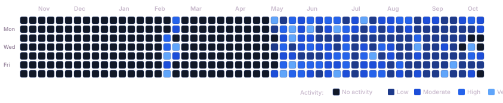

<div align="center">

  <!-- TOP GRADIENT BANNER — Dark Amethyst & Midnight Violet Theme -->
  

  <br/>

  <!-- PROFILE & SOCIAL PILL BADGES -->
  <a href="https://leetcode.com/smkyuzarsif/" target="_blank">
    
  </a>
  <a href="https://github.com/konaineleo" target="_blank">
    
  </a>
  
  

</div>

---

## ⚡ Live LeetCode Performance

<div align="center">

  <!-- STAT BADGES ROW IN EXACT PALETTE -->
  
  
  
  
  

  <br/><br/>

  <!-- MONOCHROMATIC ROYAL BLUE LEETCODE HEATMAP -->
  <a href="https://leetcode.com/smkyuzarsif/" target="_blank">
    
  </a>

  <br/><br/>

  <!-- CONTEST RATING DASHBOARD -->
  <table border="0" cellspacing="8" cellpadding="0">
    <tr>
      <td align="center">
        <a href="https://leetcode.com/smkyuzarsif/" target="_blank">
          
        </a>
      </td>
    </tr>
  </table>

</div>

---

## 🐙 GitHub Contribution Grid

<div align="center">

  <table border="0" cellspacing="0" cellpadding="16" style="background-color: #0B0033; border: 1px solid #832232; border-radius: 14px;">
    <tr>
      <td align="center">
        <a href="https://github.com/konaineleo" target="_blank">
          
        </a>
      </td>
    </tr>
  </table>

</div>

---

## 📊 Comprehensive Profile Metrics

| Metric | Value | Breakdown & Context |
| :--- | :--- | :--- |
| **LeetCode Profile** | [`@smkyuzarsif`](https://leetcode.com/u/smkyuzarsif/) | Verified public profile |
| **Global Ranking** | **#339,788** | Across all active global competitors |
| **Total Solved** | **391** | 212 Easy • 161 Medium • 18 Hard |
| **Contest Rating** | **1530.99** | Global Contest Rank: #323,721 (Top 36.83%) |
| **Rated Contests** | **22** | Live Biweekly & Weekly contest rounds |
| **Daily Streak** | **1 day** (Active) | **144 days** (All-time personal record) |
| **Primary Language**| **Java (385 solved)** | Secondary: MySQL (6 solved) |
| **Verified Badges** | **3** | 100 Days Badge, 50 Days Badge, DCC 2026 |

---

## 🏅 Earned Badges

<p align="left">
  
  
  
</p>

---

## 💻 Languages Breakdown

```text
Java    ████████████████████████████████████████ 385 problems (98.5%)
MySQL   █ 6 problems (1.5%)
```

---

<div align="center">
  <sub>Tracked automatically via <a href="https://github.com/konaineleo/leetcode-progress">LeetCode × GitHub Progress Tracker</a></sub>
</div>
